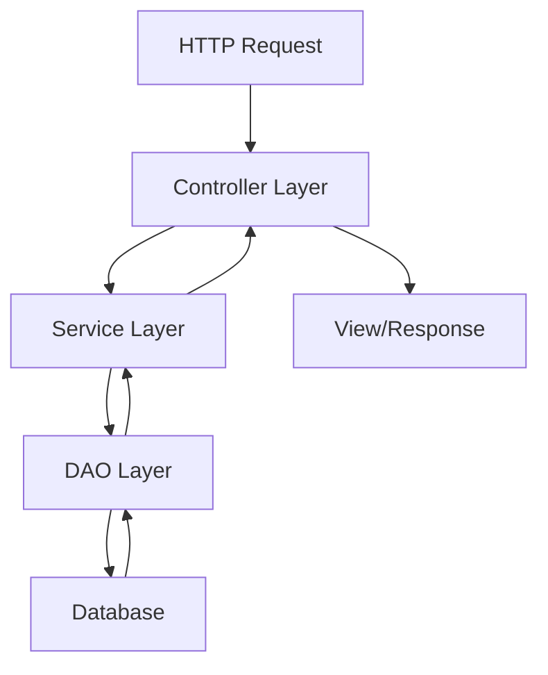

# Direction / Learning

> Organized from existing Repository Intelligence asset (`context_md`).

## Deployment Notes

### Runtime Environment
- **Application Server**: Requires Java servlet container (Tomcat, Jetty, or similar)
- **Framework Stack**: Spring Framework with Hibernate ORM integration
- **Security Layer**: Spring Security for authentication and authorization
- **Web Flow**: Spring Web Flow for complex page navigation

### Deployment Topology

### Component Distribution
- **Web Layer**: Controllers handle HTTP requests and responses
- **Business Layer**: Services contain business logic and transaction management
- **Data Layer**: DAOs manage database interactions through Hibernate
- **Domain Layer**: Model classes represent business entities

### Runtime Dependencies
- Spring Framework core modules
- Hibernate ORM for database persistence
- Spring Security for authentication/authorization
- Spring Web Flow for stateful web interactions
- Database connectivity (JDBC drivers)

## Data Flows

The ECommerce application follows a layered architecture with well-defined data flows between components:

### Request Processing Flow

### Authentication Flow

1. **User Login Request**
   - `GET /login` → Login page display
   - User credentials submitted
   - SecurityConfiguration processes authentication
   - CustomSuccessHandler manages post-login routing

2. **User Registration Flow**
   - `GET /register` → Registration page
   - `GET /Registration` → Registration form
   - User data validation and account creation

### Admin Management Flows

**Category Management:**
- `GET /admin/dashboard` → Admin dashboard
- `GET /admin/categorys/category` → Category listing
- `POST /admin/categorys/add` → Create new category
- `GET /admin/categorys/edit/{category_id}` → Edit category form
- `POST /admin/categorys/edit/{category_id}` → Update category
- `GET /admin/categorys/delete/{category_id}` → Delete category

**Product Management:**
- `GET /admin/products/product` → Product listing
- `POST /admin/products/add` → Create new product
- `GET /admin/products/edit/{product_id}` → Edit product form
- `POST /admin/products/edit/{product_id}` → Update product
- `GET /admin/products/delete/{product_id}` → Delete product

**User Management:**
- `GET /admin/users/user` → User listing
- `GET /admin/users/changeStatus/{id}` → Toggle user status
- `GET /admin/users/delete/{id}` → Delete user

### Customer Shopping Flows

**Cart Operations:**
- `GET /addCart` → Add item to cart
- `GET /{username}/cart` → View user's cart
- `GET /{username}/cart/remove-cart/{cart_id}` → Remove from cart

**Wishlist Operations:**
- `GET /user/addWishlistItem` → Add to wishlist
- `GET /user/{username}/wishlist` → View user's wishlist
- `GET /user/{username}/wishlist/remove-wishlist/{wishlist_id}` → Remove from wishlist

**Account Management:**
- `GET /user/{username}/account` → View account details
- `GET /user/{username}/account/edit-details/{user_id}` → Edit account form
- `POST /user/{username}/account/edit-details/updatingAccount/{user_id}` → Update account
- `POST /updatingAccount-{id}` → Alternative account update endpoint

### Product Discovery Flow

- `GET /` → Home page with featured products
- `GET /displayProduct/productsList` → All products listing
- `GET /displayProduct/productList/categorywise/{category_id}` → Category-filtered products
- `GET /SearchController` → Product search functionality
- `GET /descriptionPage` → Product detail view

### Data Layer Interactions

Each business operation follows the pattern:
1. **Controller** receives HTTP request
2. **Service Layer** implements business logic
3. **DAO Layer** handles data persistence
4. **Model Classes** represent domain entities

Key entity relationships:
- Products belong to Categories and are supplied by Suppliers
- Carts and Wishlists belong to Users
- All operations maintain referential integrity through proper DAO implementations