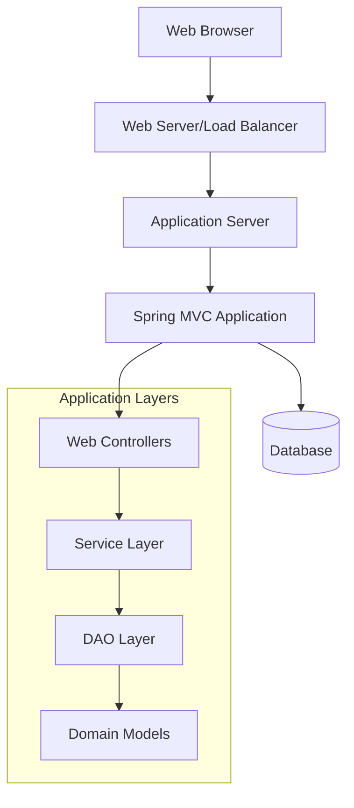

# Provenance / Boundary

> Organized from existing Repository Intelligence asset (`context_md`).

## External Integrations

The ECommerce application integrates with several external systems and services to provide comprehensive functionality:

### Database Integration

The application uses a layered data access architecture with DAO (Data Access Object) pattern implementations:

- **Category Data Access**: `CategoryDaoImpl` implements `CategoryDao` for category management operations
- **Product Data Access**: `ProductDaoImpl` implements `ProductDao` for product catalog operations  
- **User Data Access**: `UserDaoImpl` implements `UserDao` for user account management
- **Cart Data Access**: `CartDaoImpl` implements `CartDao` for shopping cart persistence
- **Supplier Data Access**: `SupplierDaoImpl` implements `SupplierDao` for supplier information management

### Email Services

The system includes email functionality through:

- **Mail Service**: `MailServiceImpl` implements `MailService` interface for email notifications and communications
- **Contact Integration**: Contact us functionality (`/contactUs`) for customer inquiries

### Authentication & Security

- **Custom Authentication**: `SecurityConfiguration` uses `CustomSuccessHandler` for specialized authentication flows
- **Session Management**: User session handling for cart and wishlist persistence
- **Access Control**: Role-based access with admin dashboard restrictions

### Third-Party Service Endpoints

The application exposes integration points for:

- **Database Administration**: `/db` endpoint for database management tools
- **External Search**: Search functionality through `SearchController` for product discovery
- **Order Processing**: Customer order integration via `/customerOrder` endpoint

### Service Layer Architecture

Business logic is abstracted through service interfaces:

- **Category Services**: `CategoryServiceImpl` implements `CategoryService`
- **Product Services**: `ProductServiceImpl` implements `ProductService`  
- **User Services**: `UserServiceImpl` implements `UserService`
- **Supplier Services**: `SupplierServiceImpl` implements `SupplierService`

core business logic

## Deployment Notes

Based on the Spring MVC architecture, this application follows a typical Java web application deployment pattern:

### Runtime Environment
- **Application Server**: Requires Java servlet container (Tomcat, Jetty, or similar)
- **Framework Stack**: Spring Framework with Hibernate ORM integration
- **Security Layer**: Spring Security for authentication and authorization
- **Web Flow**: Spring Web Flow for complex page navigation

### Deployment Topology

### Component Distribution
- **Web Layer**: Controllers handle HTTP requests and responses
- **Business Layer**: Services contain business logic and transaction management
- **Data Layer**: DAOs manage database interactions through Hibernate
- **Domain Layer**: Model classes represent business entities

### Runtime Dependencies
- Spring Framework core modules
- Hibernate ORM for database persistence
- Spring Security for authentication/authorization
- Spring Web Flow for stateful web interactions
- Database connectivity (JDBC drivers)

*Note: Specific deployment configuration details are not available in the current codebase documentation.*