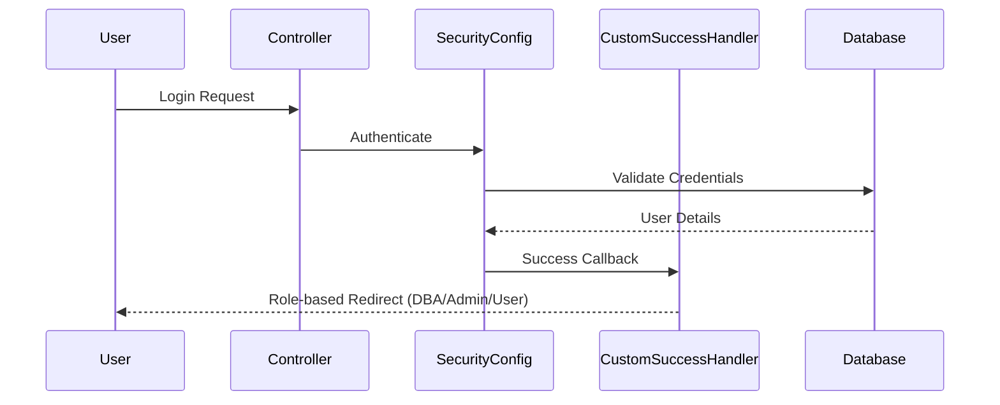
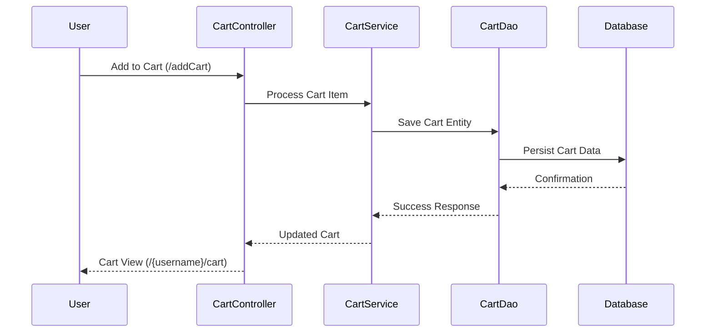
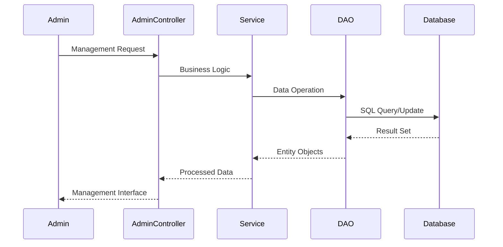

# Provenance / Dependency


> Organized from existing Repository Intelligence asset (`architecture_md`).

## Dependency Analysis

### Internal Dependencies

#### Framework Dependencies

**Spring Framework Stack**
- **Spring MVC**: Core web framework providing controller layer and request handling
- **Spring Security**: Authentication and authorization framework with role-based access control
- **Spring Web Flow**: Workflow management for complex user interactions
- **Hibernate ORM**: Object-relational mapping for database operations

#### Architectural Layer Dependencies

**Controller → Service Layer**
- Controllers depend on service interfaces for business logic execution
- Examples: `CartController` → `CartService`, `ProductController` → `ProductService`
- **Rationale**: Separation of concerns, enabling testability and maintainability

**Service → DAO Layer**
- Service implementations depend on DAO interfaces for data persistence
- Examples: `CategoryServiceImpl` → `CategoryDao`, `UserServiceImpl` → `UserDao`
- **Rationale**: Abstraction of data access logic, supporting multiple persistence strategies

**DAO → Model Entities**
- DAO implementations operate on domain model classes
- Examples: `CartDaoImpl` → `Cart`, `ProductDaoImpl` → `Product`
- **Rationale**: Type-safe data operations with clear domain boundaries

#### Configuration Dependencies

**Security Configuration Chain**
- `SecurityConfiguration` → `CustomSuccessHandler` for authentication flow
- `SecurityWebApplicationInitializer` → `SecurityConfiguration`
- **Rationale**: Centralized security configuration with custom authentication handling

**MVC Configuration Chain**
- `HelloWorldConfiguration` → `WebFlowConfig` for flow management
- `SpringMvcInitializer` → `HelloWorldConfiguration`
- **Rationale**: Modular configuration supporting complex user workflows

### External Dependencies

#### Database Dependencies
- **Hibernate ORM**: Database abstraction and object mapping
- **Database Driver**: JDBC driver for target database system
- **Rationale**: Standardized data access with database vendor independence

#### Mail Service Dependencies
- **Mail Service Implementation**: External SMTP server integration
- **JavaMail API**: Standard email functionality
- **Rationale**: User communication capabilities for notifications and confirmations

#### Web Container Dependencies
- **Servlet Container**: Application server for web application hosting
- **JSP/JSTL**: View layer rendering technology
- **Rationale**: Standard Java EE deployment model with mature tooling support

### Dependency Management Strategy

#### Interface-Based Design
- All service and DAO components use interface-implementation pattern
- Enables dependency injection and testing with mock implementations
- **Benefits**: Loose coupling, enhanced testability, flexible implementation swapping

#### Layered Dependency Flow

```
Controllers → Services → DAOs → Models
     ↓           ↓        ↓
Views    Business  Data   Domain
         Logic    Access  Objects
```

#### Configuration Isolation
- Separate configuration classes for different concerns (Security, MVC, Hibernate)
- **Benefits**: Modular configuration, easier maintenance, clear separation of responsibilities

## Integration Design

### External Systems and APIs

The ECommerce application exposes a comprehensive REST API for both administrative and user-facing operations. The API follows RESTful conventions and provides endpoints for:

#### Administrative APIs
- **Category Management**: CRUD operations for product categories
  - `GET /admin/categorys/category` - View categories
  - `POST /admin/categorys/add` - Add new category
  - `GET /admin/categorys/edit/{category_id}` - Edit category
  - `GET /admin/categorys/delete/{category_id}` - Delete category

- **Product Management**: Full product lifecycle management
  - `GET /admin/products/product` - View products
  - `POST /admin/products/add` - Add new product
  - `GET /admin/products/edit/{product_id}` - Edit product
  - `GET /admin/products/delete/{product_id}` - Delete product

- **User Management**: Administrative user operations
  - `GET /admin/users/user` - View users
  - `GET /admin/users/changeStatus/{id}` - Change user status
  - `GET /admin/users/delete/{id}` - Delete user

- **Supplier Management**: Supplier relationship management
  - `GET /admin/suppliers/supplier` - View suppliers
  - `POST /admin/suppliers/add` - Add supplier
  - `GET /admin/suppliers/edit/{supplier_id}` - Edit supplier
  - `GET /admin/suppliers/delete/{supplier_id}` - Delete supplier

#### User-Facing APIs
- **Authentication & Registration**:
  - `GET /login` - Login page
  - `GET /register` - User registration
  - `GET /logout` - User logout

- **Shopping Cart Operations**:
  - `GET /{username}/cart` - View user cart
  - `GET /addCart` - Add items to cart
  - `GET /{username}/cart/remove-cart/{cart_id}` - Remove from cart

- **Wishlist Management**:
  - `GET /user/{username}/wishlist` - View wishlist
  - `GET /user/addWishlistItem` - Add to wishlist
  - `GET /user/{username}/wishlist/remove-wishlist/{wishlist_id}` - Remove from wishlist

- **Account Management**:
  - `GET /user/{username}/account` - View account
  - `GET /user/{username}/account/edit-details/{user_id}` - Edit account
  - `POST /user/{username}/account/edit-details/updatingAccount/{user_id}` - Update account

#### Product Discovery APIs
- `GET /displayProduct/productsList` - Browse all products
- `GET /displayProduct/productList/categorywise/{category_id}` - Filter by category
- `GET /SearchController` - Product search functionality
- `GET /descriptionPage` - Product details

### Integration Patterns

#### Service Layer Integration
The application uses a layered service architecture where:
- Controllers handle HTTP requests and delegate to service layer
- Service implementations (`CategoryServiceImpl`, `ProductServiceImpl`, `UserServiceImpl`) provide business logic
- DAO implementations handle data persistence

#### Mail Service Integration
The system includes a `MailService` interface with implementation (`MailServiceImpl`) for:
- User registration confirmations
- Order notifications
- Account updates

#### Security Integration
Security is handled through:
- `SecurityConfiguration` with custom success handlers
- `CustomSuccessHandler` for post-authentication routing
- Role-based access control for admin vs user endpoints

### Data Integration

The application integrates data through well-defined entity relationships:
- Products belong to Categories and are supplied by Suppliers
- Carts and Wishlists belong to Users
- All entities are managed through corresponding DAO interfaces

### Configuration Integration

The system uses Spring configuration classes:
- `HelloWorldConfiguration` for MVC setup
- `WebFlowConfig` for web flow management
- `SecurityConfiguration` for authentication and authorization

## Data Flow Design

The ECommerce application follows a structured data flow pattern through its layered architecture, with clear separation between presentation, business logic, and data access layers.

### User Authentication Flow



### Product Management Data Flow

1. **Admin Product Operations**:
   - Admin accesses dashboard via `/admin/dashboard`
   - AdminProductController handles CRUD operations
   - ProductServiceImpl processes business logic
   - ProductDaoImpl executes database operations
   - Product entities are persisted via Hibernate

2. **User Product Browsing**:
   - ProductController serves product display pages
   - Service layer retrieves product data with category and supplier relationships
   - Products are filtered and presented to users

### Shopping Cart Data Flow



### User Account Management Flow

1. **Registration Process**:
   - User submits registration via `/register`
   - UserAccountController validates input
   - UserServiceImpl processes business rules
   - UserDaoImpl creates user entity
   - User relationships (cart, wishlist) are initialized

2. **Account Updates**:
   - User edits details via account interface
   - updateAccountDetails handler processes POST requests
   - Changes are validated and persisted through service/DAO layers

### Admin Management Data Flow



### Wishlist Operations Flow

1. **Add to Wishlist**:
   - User triggers `/user/addWishlistItem`
   - WishlistController processes request
   - User-wishlist relationship is established
   - Wishlist entity is persisted

2. **View Wishlist**:
   - User accesses `/user/{username}/wishlist`
   - Controller retrieves user-specific wishlist items
   - Items are displayed with removal options

### Configuration and Security Flow

1. **Application Initialization**:
   - SpringMvcInitializer bootstraps MVC configuration
   - SecurityWebApplicationInitializer sets up security
   - HibernateConfiguration establishes database connectivity
   - HelloWorldConfiguration configures view resolvers and mail services

2. **Request Processing**:
   - SecurityConfiguration intercepts requests
   - Authentication is validated
   - CustomSuccessHandler routes based on user roles
   - Controllers process business logic
   - Views are rendered and returned to users