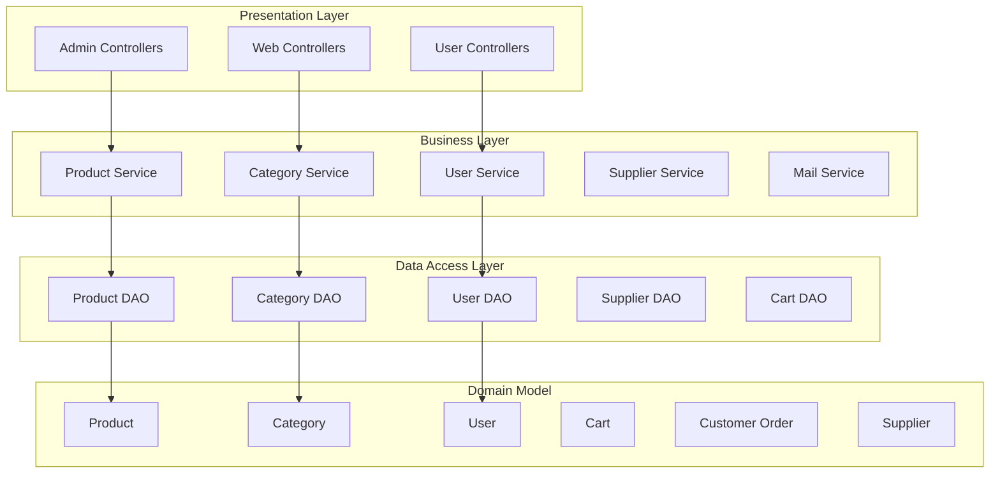
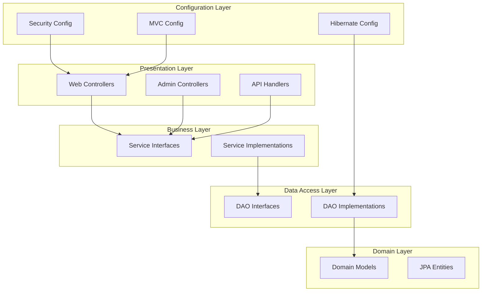

# Provenance / Structural

> Organized from existing Repository Intelligence asset (`architecture_md`).

## Architecture Overview

The ECommerce application follows a traditional **Spring MVC layered architecture** with clear separation of concerns

### Design Philosophy

The system is built on proven enterprise Java patterns:
- **Layered Architecture**: Clear separation between presentation, business, and data access layers
- **Interface-Implementation Pattern**: All services and DAOs define contracts through interfaces
- **MVC Pattern**: Web layer follows Model-View-Controller paradigm
- **Dependency Injection**: Spring framework manages component dependencies

### Core Architecture Layers

### Component Architecture

#### Web Layer
- **HelloWorldController**: Main application controller handling home page
- **Admin Controllers**: Specialized controllers for administrative functions
  - `AdminCategoryController`: Category management operations
  - `AdminProductController`: Product management operations
  - `AdminUserController`: User management operations
  - `AdminSupplierController`: Supplier management operations
- **User Controllers**: Customer-facing functionality
  - `CartController`: Shopping cart operations
  - `ProductController`: Product browsing and search
  - `UserAccountController`: Account management
  - `WishlistController`: Wishlist operations

#### Service Layer
Business logic is encapsulated in service interfaces with concrete implementations:
- **CategoryService/CategoryServiceImpl**: Category business operations
- **ProductService/ProductServiceImpl**: Product business operations
- **UserService/UserServiceImpl**: User account business operations
- **SupplierService/SupplierServiceImpl**: Supplier business operations
- **MailService/MailServiceImpl**: Email notification services

#### Data Access Layer
Data persistence follows the DAO pattern with interface-implementation separation:
- **CategoryDao/CategoryDaoImpl**: Category data operations
- **ProductDao/ProductDaoImpl**: Product data operations
- **UserDao/UserDaoImpl**: User data operations
- **SupplierDao/SupplierDaoImpl**: Supplier data operations
- **CartDao/CartDaoImpl**: Shopping cart data operations

#### Domain Model
Core business entities with JPA/Hibernate mappings:
- **Product**: Product catalog with pricing, categories, and supplier relationships
- **Category**: Product categorization with hierarchical support
- **User**: User accounts with roles and authentication
- **Cart**: Shopping cart with user associations
- **CustomerOrder**: Order processing with payment and shipping details
- **Supplier**: Product supplier information
- **Roles**: User role management
- **ShippingDetails**: Order shipping information

### Configuration Architecture

The application uses Java-based configuration:
- **HelloWorldConfiguration**: Spring MVC setup with view resolvers and mail configuration
- **HibernateConfiguration**: ORM configuration with data source and session factory
- **SecurityConfiguration**: Spring Security setup with authentication and authorization
- **CustomSuccessHandler**: Role-based authentication success handling (DBA, Admin, User)
- **WebFlowConfig**: Spring Web Flow configuration for complex page flows
- **SpringMvcInitializer**: Web application initialization
- **SecurityWebApplicationInitializer**: Security filter initialization

### Key Architectural Patterns

1. **Interface Segregation**: All services and DAOs define clear contracts
2. **Dependency Inversion**: High-level modules depend on abstractions
3. **Single Responsibility**: Each component has a focused purpose
4. **Role-Based Access Control**: Security integrated at the architectural level
5. **Transaction Management**: Declarative transaction handling through Spring

## High-Level Design

### System Boundaries

### Core Subsystems

#### 1. User-Facing Subsystem
- **Components**: `HelloWorldController`, `ProductController`, `CartController`, `WishlistController`, `UserAccountController`
- **Responsibilities**: Handle customer interactions, product browsing, cart management, and user account operations
- **Boundaries**: Serves public endpoints and authenticated user operations

#### 2. Administrative Subsystem
- **Components**: `AdminCategoryController`, `AdminProductController`, `AdminSupplierController`, `AdminUserController`
- **Responsibilities**: Manage categories, products, suppliers, and users through admin dashboard
- **Boundaries**: Restricted to admin role with specialized management interfaces

#### 3. Security Subsystem
- **Components**: `SecurityConfiguration`, `CustomSuccessHandler`, `SecurityWebApplicationInitializer`
- **Responsibilities**: Authentication, authorization, and role-based access control
- **Boundaries**: Cross-cutting concern protecting all application endpoints

#### 4. Data Management Subsystem
- **Components**: Service layer (`CategoryService`, `ProductService`, `UserService`, etc.) and DAO layer (`CategoryDao`, `ProductDao`, `UserDao`, etc.)
- **Responsibilities**: Business logic processing and data persistence operations
- **Boundaries**: Encapsulates all database interactions and business rules

### Architectural Layering

#### Layer 1: Presentation (Controllers)
- Handles HTTP requests and responses
- Route mapping and request validation
- View rendering and model binding

#### Layer 2: Business Logic (Services)
- Implements core business rules
- Transaction management
- Cross-cutting concerns like validation and security

#### Layer 3: Data Access (DAOs)
- Database operations and queries
- Entity mapping and persistence
- Data consistency and integrity

#### Layer 4: Domain Models
- Core business entities (`User`, `Product`, `Cart`, `Category`, `CustomerOrder`)
- Relationship definitions and constraints
- Data structure representation

### Integration Points

- **Spring MVC Integration**: Controllers integrate with view resolvers and model binding
- **Hibernate Integration**: DAO implementations use Hibernate for ORM operations
- **Security Integration**: All layers protected by Spring Security configuration
- **Mail Service Integration**: Notification system integrated across user operations

## Component Design

### Core Components

The ECommerce application follows a layered architecture with distinct component responsibilities:

#### Web Layer Components

**Controllers**
- `HelloWorldController`: Main application controller handling home page requests
- `CartController`: Manages shopping cart operations (add, remove, view)
- `ProductController`: Handles product display, search, and description pages
- `UserAccountController`: Manages user account details and updates
- `WishlistController`: Handles wishlist operations (add, remove, view)

**Admin Controllers**
- `AdminController`: Base admin controller class (package-private)
- `AdminCategoryController`: Category management CRUD operations
- `AdminProductController`: Product management operations
- `AdminSupplierController`: Supplier management operations
- `AdminUserController`: User management operations

#### Service Layer Components

**Service Interfaces and Implementations**
- `CategoryService` / `CategoryServiceImpl`: Category business logic
- `ProductService` / `ProductServiceImpl`: Product business logic
- `SupplierService` / `SupplierServiceImpl`: Supplier business logic
- `UserService` / `UserServiceImpl`: User business logic
- `MailService` / `MailServiceImpl`: Email functionality

#### Data Access Layer Components

**DAO Interfaces and Implementations**
- `CategoryDao` / `CategoryDaoImpl`: Category data access operations
- `ProductDao` / `ProductDaoImpl`: Product data access operations
- `SupplierDao` / `SupplierDaoImpl`: Supplier data access operations
- `UserDao` / `UserDaoImpl`: User data access operations
- `CartDao` / `CartDaoImpl`: Shopping cart data access operations

#### Model Components

**Domain Entities**
- `User`: User entity with email, mobile, role, active status
- `Product`: Product entity with price, image, description, discount
- `Category`: Product category entity with name and description
- `Cart`: Shopping cart entity with quantity, total, user, and status
- `CustomerOrder`: Order entity with payment mode, grand total, status
- `Supplier`: Supplier entity for product sourcing
- `Roles`: User role definitions
- `ShippingDetails`: Shipping information model

#### Configuration Components

**Spring Configuration Classes**
- `HelloWorldConfiguration`: Spring MVC configuration with flow adapters and view resolvers
- `HibernateConfiguration`: Hibernate ORM configuration with data source and session factory
- `SecurityConfiguration`: Spring Security configuration with authentication setup
- `CustomSuccessHandler`: Authentication success handler with role-based redirect logic
- `WebFlowConfig`: Web flow configuration
- `SpringMvcInitializer`: Spring MVC initializer
- `SecurityWebApplicationInitializer`: Security web application initializer

### Component Interactions

#### Request Flow
1. **HTTP Requests** → Controllers receive and route requests
2. **Controllers** → Delegate business logic to service layer
3. **Services** → Use DAO layer for data persistence operations
4. **DAOs** → Interact with database through Hibernate ORM

#### Key Relationships
- Controllers depend on service interfaces for business logic
- Service implementations use DAO interfaces for data access
- All DAO implementations follow the interface-implementation pattern
- Domain entities have established relationships (User→Cart, Product→Category, Product→Supplier)

#### Security Integration
- `SecurityConfiguration` integrates with `CustomSuccessHandler` for role-based authentication
- Role-based access control differentiates between DBA, Admin, and User roles

### Component Dependencies

**Configuration Dependencies**
- `HelloWorldConfiguration` depends on `WebFlowConfig` for web flow setup
- `SecurityConfiguration` uses `CustomSuccessHandler` for authentication flow

**Service Layer Dependencies**
- All service implementations depend on their corresponding DAO interfaces
- Controllers depend on service interfaces, not implementations

**Data Layer Dependencies**
- DAO implementations use Hibernate session factory from `HibernateConfiguration`
- Entity relationships managed through JPA annotations and Hibernate ORM